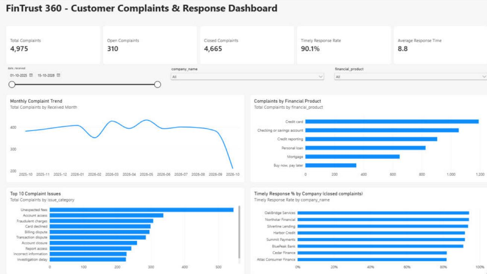

# FinTrust 360 – Financial Customer Complaints & Response Analytics

Final project for the **Tekloomy Data Analytics Internship**.
I analysed 5,000 (fictional) financial-service complaint records using **Excel, MySQL and Power BI** to find the most common customer problems, check how quickly companies respond, and suggest improvements.

**Role:** Junior Operations Data Analyst (intern)
**Author:** Sree Divya Ledalla



---

## Business problem

A financial-services customer experience team receives complaints about credit cards, bank accounts, loans, payments and other products. Management wants to know:

- Which complaints happen most often?
- How complaint numbers change over time.
- Whether customers get a reply on time.

## Tools used

| Tool | What I used it for |
|---|---|
| Microsoft Excel | Cleaning the data, cleaning log, quick summary with COUNTIF / AVERAGEIF |
| MySQL 8.0 | Analysis with 12 SQL queries |
| Power BI Desktop | Interactive dashboard with KPIs, charts and slicers |

## Repository structure

```
FinTrust360-Complaint-Analytics/
├── data/
│   ├── FinTrust360_raw_lecture-file.csv     # original dataset (not changed)
│   └── FinTrust360_cleaned.csv              # cleaned data used for SQL and Power BI
├── excel/
│   └── FinTrust360_Cleaned_Data.xlsx        # Raw_Data, Cleaned_Data, Cleaning_Log, Summary sheets
├── sql/
│   ├── FinTrust360_Analysis.sql             # table creation, data load and 12 explained queries
│   └── sql_outputs.txt                      # results of the queries
├── dashboard/
│   ├── FinTrust360_Dashboard.pbix           # Power BI report
│   └── FinTrust360_Dashboard_Screenshot.png
├── report/
│   └── FinTrust360_Analysis_Report.pdf      # findings and recommendations
├── AI_USAGE.md
└── README.md
```

## Dataset

- 5,000 rows, 14 columns, one row per complaint
- Complaints received from **1 Oct 2025 to 15 Oct 2026**
- Main columns: complaint_id, date_received, financial_product, issue_category, company_name, state, response_due_date, date_company_responded, response_status, timely_response

## Step 1 – Data cleaning (Excel)

| Problem | What I did | Rows |
|---|---|---|
| Exact duplicate rows | Remove Duplicates | 25 removed |
| Product names with extra spaces / small letters | TRIM + fixed capitals → 6 clean names | 26 |
| Submission channel with extra spaces / small letters | TRIM + PROPER → 4 clean names | 17 |
| Missing state | Filled with "Unknown" | 49 |
| Dates, response info, timely flag | Checked – no problems found | 0 |

Result: **5,000 → 4,975 clean complaints.** All steps are written in the `Cleaning_Log` sheet.

## Step 2 – SQL analysis (MySQL)

The SQL file creates the table, loads the cleaned CSV and runs 12 queries:

1. Total complaints
2. Open vs closed complaints
3. Monthly complaint trend
4. Complaints by financial product
5. Top 10 issues
6. Complaints by company
7. Top 10 states
8. Overall timely-response %
9. Timely-response % by company
10. Average response time
11. Response time and timely % by product
12. Age of open complaints (backlog)

> Open complaints are **excluded** from timely % and average response time because they do not have a response yet.

**How to run:**

1. Start MySQL with `mysql --local-infile=1 -u root -p`.
2. MySQL 8 blocks loading local files by default. The SQL file runs `SET GLOBAL local_infile = 1;` before loading the data to turn this on (this needs an admin user such as root).
3. Change the CSV path in the `LOAD DATA` line to where the file is saved on your computer, then run the file.

## Step 3 – Power BI dashboard

- **5 KPIs:** Total Complaints, Open Complaints, Closed Complaints, Timely Response Rate, Average Response Time (in days)
- **Line chart:** monthly complaint trend
- **Bar charts:** complaints by product, top 10 issues, timely response % by company
- **Slicers:** date range, company, financial product

DAX measures used:

```DAX
Total Complaints = COUNTROWS(FinTrust360_cleaned)
Open Complaints = CALCULATE([Total Complaints], FinTrust360_cleaned[response_status] = "Open")
Closed Complaints = CALCULATE([Total Complaints], FinTrust360_cleaned[response_status] = "Closed")
Timely Response Rate = DIVIDE(CALCULATE([Total Complaints], FinTrust360_cleaned[response_status] = "Closed", FinTrust360_cleaned[timely_response] = "Yes"), [Closed Complaints])
Average Response Time = AVERAGEX(FILTER(FinTrust360_cleaned, FinTrust360_cleaned[response_status] = "Closed"), DATEDIFF(FinTrust360_cleaned[date_received], FinTrust360_cleaned[date_company_responded], DAY))
```

**Opening the .pbix on another computer:** the data is saved inside the file, so the dashboard opens and works without the CSV. To use **Refresh**, point the report to the CSV on that computer: Home → Transform data → **Data source settings** → select the source → **Change Source** → browse to `data/FinTrust360_cleaned.csv` → OK → **Refresh**.

## Key results

| KPI | Value |
|---|---|
| Total complaints | 4,975 |
| Open complaints | 310 |
| Closed complaints | 4,665 |
| Timely response rate | 90.1% |
| Average response time | 8.8 days |

## Key findings

1. **Credit card** (1,191) and **checking/savings account** (1,054) complaints are the highest – about 45% of all complaints.
2. **Unexpected fees** is the most common issue (545 complaints, 11%).
3. Complaint volume is **stable** at about 400 per month. The low number in October 2026 is because data stops on 15 Oct.
4. **Atlas Consumer Finance (81.8%)** and **Cedar Finance (81.9%)** have the lowest timely-response rates – the other companies are at 91–94%.
5. **Mortgage** complaints are the slowest (81.2% timely, 9.8 days), and **226 of the 310 open complaints** are older than 90 days.

## Recommendations

1. Help Atlas Consumer Finance and Cedar Finance improve on-time replies (reminders before the 15-day due date, weekly tracking, target 90%+).
2. Clear the backlog of old open complaints, starting with the oldest ones.
3. Reduce "unexpected fees" complaints with clearer fee information and fee alerts, and give extra attention to mortgage complaint handling.

## Notes

- More complaints does not always mean a worse company, because company sizes are different.
- A timely response does not guarantee the customer was satisfied.
- All companies and records in this dataset are fictional.

## What I learned

- Why data cleaning matters before any analysis
- Writing SQL queries with GROUP BY, WHERE, DATEDIFF and DATE_FORMAT
- Creating DAX measures, slicers and a Top N filter in Power BI
- Using the correct denominator when calculating rates
